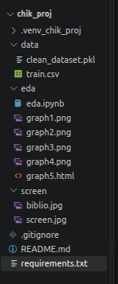
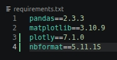
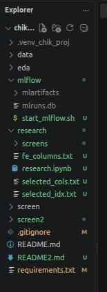
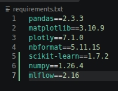

# Лабораторная работа №1 - Настройка окружения и разведочный анализ данных

## Описание проекта

Проект посвящен первичному развертыванию рабочего окружения и проведению разведочного анализа данных (на наборе данных Mobile Price Classifications - https://www.kaggle.com/datasets/iabhishekofficial/mobile-price-classification?resource=download)

Цель - классификация смартфонов по 4 ценовым категорям на основе аппаратных характеристик

# Запуск - Как запустить проект

## Инструкция по развертыванию проекта на новой машине

### 1) Клонирование 

Перешел в корневую директорию проекта (либо создал командой **mkdir**) и клонировал проект из удаленного репозитория в VS Code с помощью команды:

**git clone https://github.com/wwwmctss/PROJ1.git**

Из папки PROJ1 перенес файлы в корневую папку.

### 2) Настройка виртуального окружения

Создал изолированное виртуальное окружение Python в корне проекта и активировал его:

**python -m venv .venv_chik_proj**

**source .venv_chik_proj/bin/activate**

### 3) Установка зависимостей

Обновил пакетный менеджер pip и установил все требуемые библиотеки, которые записаны в requirements.txt:

**pip install --upgrade pip**

**pip install -r requirements.txt**

### 4) Подготовка данных

- Убедился в наличии директории data/ (либо создал ее командой **mkdir data**)

- Поместил исходный обучающий файл с Kaggle (train.csv) в папку data/

### 5) Запуск

- Открыл интерактивный блокнот eda/eda.ipynb

- В правом верхнем углу интерфейса редактора выбрал ядро .venv_chik_proj

- Последовательно выполнил все ячейки блокнота

## Описание модулей проекта и результаты EDA

### Структура проекта

В .gitignore зафиксировано то, что мы не коммитим (*.csv, *.pkl, .venv*).

screen/ - скриншоты, используемые в README.md.

clean_dataset.pkl - очищенный датасет.

### Используемые библиотеки

### Результаты разведочного анализа данных

1. Данные + очистка:

- Количество строк и столбцов: 2000 x 21. Все данные числовые (int64, float64), пропуски и дубликаты отсутствуют.

- Обнаружены некорректные, с точки зрения физических свойств объекта, нулевые значения в столбцах ширины экрана (sc_w) и вертикального разрешения экрана в пикселях (px_height). Нули заменены на медианные значения соответствующих колонок.

2. Создание нового признака:

- screen_area: физическая площадь дисплея в квадртаных сантиметрах (sc_h * sc_w).

3. Ключевые закономерности и выводы:

- Баланс классов: Выборка идеально сбалансирована — на каждый из 4 ценовых классов приходится ровно по 500 записей (25%).

- Доминирующий признак: Объем оперативной памяти (ram) является главным разделяющим фактором для классификации. Между классами практически нет пересечений по квартилям: бюджетные модели имеют RAM до 1500 Мб, флагманы - выше 3000 Мб.

- Вторичные признаки: Емкость аккумулятора (battery_power) и площадь экрана (screen_area) показывают умеренную положительную связь с целевым классом — чем выше ценовая категория, тем выше медианные значения параметров.

- Интерактивный анализ: График graph5.html подтверждает независимость распределения RAM от батареи: даже при слабом аккумуляторе телефоны с большим объемом оперативной памяти уверенно относятся к старшей ценовой категории.

## Финальные команды для сохранения файлов проекта

Убеждаемся что данные не коммитятся:

git status

Фиксируем и отправляем изменения на GitHub:

git add README.md eda/ requirements.txt screen/

git commit -m "..."

git push origin main

# Лабораторная работа №2 - Проведение экспериментов по настройке модели

## Описание проекта

Работа является продолжением лабораторной работы №1. Проект посвящён
настройке модели машинного обучения для задачи классификации смартфонов
по 4 ценовым категориям (датасет Mobile Price Classification -
https://www.kaggle.com/datasets/iabhishekofficial/mobile-price-classification).

Цель работы - провести ряд экспериментов по настройке модели, логируя все результаты в MLFlow. Научиться пользоваться инструментами autofeat, mlxtend, MLFlow

# Запуск - Как запустить проект

## Инструкция по развертыванию проекта на новой машине

### 1) Клонирование

Перешёл в корневую директорию проекта (либо создал командой **mkdir**) и клонировал проект из удалённого репозитория в VS Code с помощью команды:

**git clone https://github.com/wwwmctss/PROJ1.git**

Из папки PROJ1 перенёс файлы в корневую папку.

### 2) Настройка виртуального окружения

Создал изолированное виртуальное окружение Python в корне проекта и активировал его:

**python -m venv .venv_chik_proj**

**source .venv_chik_proj/bin/activate**

### 3) Установка зависимостей

Обновил пакетный менеджер pip и установил все требуемые библиотеки, которые записаны в requirements.txt:

**pip install --upgrade pip**

**pip install -r requirements.txt**

В ходе ЛР2 в requirements.txt добавлены новые пакеты:

- `numpy==1.26.4` - требуется для совместимости с `mlflow==2.16`

- `mlflow==2.16` - фреймворк для управления экспериментами

- `scikit-learn==1.7.2` - пайплайны, энкодеры, feature selection

### 4) Подготовка данных

- Убедился в наличии директории data/ (либо создал её командой **mkdir data**)

- Поместил исходный обучающий файл с Kaggle (train.csv) в папку data/

- Запустил блокнот eda/eda.ipynb из ЛР1, чтобы получить очищенный датасет clean_dataset.pkl

### 5) Запуск MLflow

MLflow запускается локально с хранилищем экспериментов в СУБД SQLite. Все артефакты и база данных находятся в директории ./mlflow (создал ее при необходимости командой **mkdir mlflow**)

Перешёл в директорию с MLflow и запустил bash-скрипт:

**cd mlflow**

**sh start_mlflow.sh**

Скрипт `start_mlflow.sh` содержит команду:

**mlflow server --backend-store-uri sqlite:///mlruns.db --host 127.0.0.1 --port 5000**

После запуска интерфейс MLflow доступен по адресу: http://localhost:5000/

Убедился, что в директории ./mlflow создана база данных mlruns.db.

### 6) Запуск исследования

- Открыл интерактивный блокнот research/research.ipynb

- В правом верхнем углу интерфейса редактора выбрал ядро .venv_chik_proj

- Последовательно выполнил все ячейки блокнота

- Параллельно проверял появление новых Run'ов в интерфейсе MLflow (http://localhost:5000/)

## Описание модулей проекта и результаты исследования

### Структура проекта

В `.gitignore` дополнительно зафиксировано, что не коммитятся артефакты MLflow: `mlflow/mlruns.db` и `mlflow/mlartifacts/`.

### Используемые библиотеки

### Описание экспериментов

Все эксперименты проводятся в `research/research.ipynb` и логируются в MLflow в эксперимент `mobile_price_experiment`.

Модель регистрируется в Model Registry под именем `mobile_price_model`.

Были проведены следующие эксперименты:

baseline: StandardScaler + TargetEncoder → RandomForest (100 деревьев) -> f1 = 0.8412, roc_auc_ovr = 0.9684

fe_sklearn: PolynomialFeatures(degree=2) для battery_power/ram/px_width, KBinsDiscretizer для clock_speed/mobile_wt -> f1 = 0.8898, roc_auc_ovr = 0.9890

rfe_feature_selection: FE sklearn + RFE (отобрано 25 признаков из 50) -> f1 = 0.9117, roc_auc_ovr = 0.9917

gridsearch_tuned: RFE-признаки + GridSearchCV по n_estimators, max_depth, max_features -> f1 = 0.9078, roc_auc_ovr = 0.9905

### Результаты исследования

Категориальными считал бинарные признаки (blue, dual_sim, four_g, three_g, touch_screen, wifi), к ним применён TargetEncoder. Для числовых признаков применен StandardScaler. В FE добавлены полиномиальные признаки battery_power, ram, px_width (degree=2) и бины для clock_speed, mobile_wt (KBinsDiscretizer, 5 бинов, quantile).

Отбор признаков сделан методом RFE из sklearn по важности RandomForest. Оставлено 25 признаков (50% от расширенного набора). Полный список сохранён в артефактах MLflow (файлы selected_cols.txt и selected_idx.txt), а также приведён ниже:

num__battery_power

num__clock_speed

num__int_memory

num__m_dep

num__mobile_wt

num__pc

num__px_height

num__px_width

num__ram

num__sc_h

num__talk_time

num__screen_area

cat__dual_sim_3

cat__four_g_2

cat__touch_screen_3

cat__wifi_0

poly__battery_power

poly__ram

poly__px_width

poly__battery_power^2

poly__battery_power ram

poly__battery_power px_width

poly__ram^2

poly__ram px_width

poly__px_width^2

**Лучшая модель.** Показала наилучшее значение f1 = 0.9117 при roc_auc_ovr = 0.9917. Это RandomForestClassifier с гиперпараметрами:

n_estimators = 200

max_depth = 10

max_features = 0.5

с препроцессингом (StandardScaler + TargetEncoder + PolynomialFeatures + KBinsDiscretizer) и отбором 25 признаков через RFE.

Production-модель. Лучший пайплайн обучен на всей выборке (2000 объектов) и залогирован в MLflow как Run production_model.

run_id = c5ae82c9535840fda6977dd957655d25

В Model Registry модель mobile_price_model зарегистрирована как Version 3 со stage Production.

## Финальные команды для сохранения файлов проекта

Убеждаемся, что артефакты MLflow и данные не коммитятся:

**git status**

Фиксируем и отправляем изменения на GitHub:

**git add research/research.ipynb mlflow/start_mlflow.sh README2.md requirements.txt .gitignore**

**git commit -m "LR2_final"**

**git push origin main**